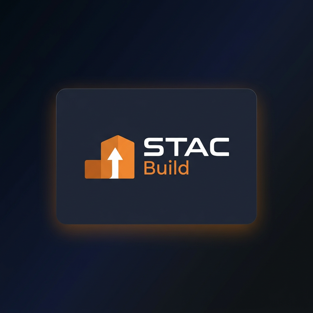

<p align="center">
  
</p>

<p align="center">
  <strong>Spatio-Temporal Awareness Core — Construction Dimensional Control System</strong>
</p>

<p align="center">
  <em>From a phone video to a certified metric point cloud, a scene mesh that copies it, a segmented and described scene, and a BIM deviation analysis — all local, all measured, all reproducible</em>
</p>

---

## What is STAC?

**STAC Build** compares **As-Built reality**, captured with a smartphone video, against the
**As-Planned design** (BIM/IFC) to detect geometric deviations and track construction progress.

One command — **Reconstruir** — turns the video into:

- a dense, **metric** point cloud whose poses, camera and depth were measured and corrected by a
  precision core, then **certified** (revisit closures, floor, chunk checks) into a final epoch;
- a **segmented scene**: every object found by a vision-language model, masked and tracked by SAM 3,
  projected onto the cloud, described in words;
- a **textured scene mesh** generated by GenRecon inside the voxels of that cloud — the cloud decides
  where there is surface, the generative model only shapes it, and the keyframes are baked onto it as
  its real texture (the generated material kept);
- the viewer, the AI assistant that answers spatial questions with deterministic tools, the BIM
  registration, deviation maps and coverage, the AR view on the phone.

Everything runs on one machine with no paid external API. Every number in a deliverable is
`tool_measured`; what a model proposed is `vlm_proposed` / `vlm_generated`; what a person confirmed is
`human_validated`. The pipeline is deterministic (`docs/plan_determinismo.md`): the same inputs and
configuration give the same cloud, bit for bit.

---

## The pipeline ("Reconstruir")

Orchestrated by `server/pipeline_manager.py`. Each stage is an isolated subprocess (its own process
group, Pipe IPC) under ONE frozen configuration (`output/run_config.yaml`, sealed by its digest); the
pipeline is resume-aware (finished stages are skipped by their artifacts) and fail-fast (a stage that
cannot do its job raises — no silent fallback). The authoritative, dated description is
[`docs/pipeline_final.md`](docs/pipeline_final.md); the working rules and every decision are in
[`CLAUDE.md`](CLAUDE.md).

```
RECONSTRUCTION ─ intake → Ω chunks → precision core F0–F6 → cloud publish (epoch 0)
      │
CLOUD → VIEWER ─ cleaned cloud + Potree octree
      │
VLM ──────────── Qwen3-VL scene analysis on every keyframe (the vocabulary of the scene)
      │
SAM3 ─────────── SAM 3.1 masks for every concept, projected onto the cloud (instances + OBBs)
      │
CERTIFY ──────── revisit closures → depth per chunk → floor → mask filter → chunk check → FINAL epoch
      │            + one description per object
MESH ─────────── GenRecon: the scene mesh generated inside the cloud's voxels, the keyframes baked onto it, published
```

### 1. Reconstruction (`workers/map_worker.py`, `server/intake/`, `server/precision/`)

- **Intake**: frame quality, parallax-uniform keyframes (one per `keyframe_motion_quantum` = 60 px of
  accumulated motion), a DA3 metric probe that measures the camera and the walk.
- **VGGT-Ω** (1B @ 512, inside the STAC fork of VGGT-Long, env `mapanything`) in **chunks planned by
  co-visibility** (`reconstruction/chunk_covis.py`: VGG-T3-style co-visibility length per keyframe,
  50 % overlap, cuts on near structure, never mid-turn — pccr → 5 chunks, a short walk → one pass),
  at the largest resolution the card holds. Sky masked per frame; the bottom 20 % of valid confidence
  and everything under 10 % of the chunk's own confidence range dropped at the source, so no pose fit
  ever runs on noise. SALAD/DINOv2 loop closures are MEASURED inside the run and applied only when a
  held-out quarter of them improves beyond its own noise.
- **Precision core F0–F6** (`claude_stac.txt` §4): the session camera (F0), a continuous metric gauge
  from DA3 anchors (F2), native-pixel tracks (F4), corrected poses and camera (F5), and **Ω's depth bent
  onto F5's landmarks** (`f6_bend`, 10-step IRLS, ±0 by held-out) with PointDiT detail at the depth
  edges only. The product is Ω's complete depth re-projected with the core's corrections — measured on
  pccr: floor-layer thickness 20.3 → 11.5 cm, the revisit duplicates of the desk and the floor closed.
  **2026-10-23 audit (branch `audit/precision-geometry-2026-10-23`, synthetic validation only so far):**
  a classical cross-check (COLMAP SIFT + vocab tree + GLOMAP, `f3_classical`), a wide-baseline loop
  bridge (MASt3R / RoMa) feeding F4, odometry priors + loop gap + scale lock + rolling-shutter correction
  in F5, COLMAP PatchMatch as fusion tier 0, the owner fusion (one point per surface element) with
  free-space carving, member-pixel mask projection and completed z-buffers in the certification — see
  `docs/pipeline_final.md` "2026-10-23" and `scripts/update_pod_precision_audit.sh`.
- **Cloud publish**: confidence gate per chunk, voxel + SOR, witness filter, consolidation with trace
  normals → `cleaned_cloud.ply` + the Potree octree, as **epoch 0** (kept, selectable).

### 2. Scene analysis and segmentation (`workers/vlm_worker.py`, `workers/sam3_worker.py`)

- **Qwen3-VL** (vLLM, local) sees **every keyframe**, one call each, and names what is there — rich
  noun phrases, no boxes, no domain filter: the system segments *everything*; the construction
  vocabulary is only a canonicalization overlay. Every phrase's fate is recorded
  (`segmentation_census.json`).
- **SAM 3.1** runs one concept session per phrase over the keyframes; its tracking IS the instance
  identity. The masks are projected onto the published cloud (per-point provenance `frame_global`,
  pixel, confidence), fused into instances with OBBs, class bytes for the viewer.
- The Autosegment window runs any subset of these stages later on the cloud on disk, with the prompts
  saved in the session; "Reconstruir" with *Segment when done* runs the whole chain in one go.

### 3. Certification (`workers/certify_worker.py`, `server/correction/`)

The correction is automatic and measured, never manual:

- **Revisit closures**: every object two separated visits saw is measured by aligning the silhouettes
  of its copies in the three orthogonal views of its own OBB (each component measured twice — the
  disagreement is the determination test). pccr's closures were 97–99 % radial: **the drift is depth,
  not pose**, so closures become depth ratios applied per chunk, about each keyframe's own camera.
- **Floor**: one rigid motion per session on the segmentation's support surfaces (floor, platform,
  slab…), levels searched along the support's own normal, THE floor = the level under the most
  cameras; the walk's start at y = 0; other real levels keep their step.
- **Mask filter** (a point tested against its own object's silhouette and the others', occlusion by
  the cloud's z-buffer), the **chunk check** (floor / ceiling / camera bands per chunk), the
  repeatability of the session measured from its own evidence (F6's held-out in metres, the seams,
  the two-copy disagreement) — never a constant when something was measured.
- The result is the **FINAL epoch** (transactional, with its own octree; Approve / Undo in the
  certification kit), the acta, and **one Qwen3-VL description per object** from its best mask views.

### 4. The scene mesh (`workers/genrecon_worker.py`, `server/tools/genrecon/`)

[GenRecon](https://github.com/kasothaphie/GenRecon) (TUM, MIT: Trellis.2 generation conditioned on
posed images, scene-scale in chunks) with the STAC patch (`genrecon_stac.patch`): **the active voxels of
every chunk come from the published cloud** (19 M points voxelised at 11.6 cm; the model's own
"sparse structure" stage, which paints floors at the chunk's base and rooms behind walls, is skipped),
the chunk cubes sit on the session's measured floor and ceiling levels, and the model only generates the
surface inside those voxels and its texture. Measured on pccr: 95 % of the mesh area within 5 cm of the
cloud, 87 % of the cloud within 5 cm of the mesh, floor and ceiling within 1 cm, objects within 1–3 cm;
the vendor's own run was 34 cm off on the floor. Every variant is measured by the same record
(`measure_mesh.py`: bands of distance both ways, the cameras' height over the floor, named objects).
The generated mesh (150 k faces per chunk, 2 k textures) is then given its REAL texture: every texel of
its own UV atlas is re-coloured from the keyframes that see its surface point (occlusion by the mesh's
depth per keyframe, the best three views blended by angle and distance), texels no keyframe sees keep
the generated colour tone-matched, and the generated metallic-roughness map stays, so the material's
look is untouched. The product lands in `output/tsdf/genrecon_photo/` (geometry and material
`vlm_generated`, base colour `tool_measured`); the raw generated mesh is kept in `output/genrecon/`.

---

## The viewer

React 18 + TypeScript + three.js, Potree streaming of the cloud with a point budget:

- **Instances** panel: every segment, its OBB, visibility, rename, delete, the floor-at-zero selector,
  the generated meshes; **Autosegment** window (prompts + stages); the **certification kit** (epochs,
  gate warnings, Approve / Undo).
- **Display**: point size, light, point opacity (the cloud can stay loaded and invisible under the
  mesh), detail budget, confidence; **shadows** (meshes cast and receive, the cloud receives);
  **light sources from the segments** — lamps become point lights, windows daylight spots.
- Measurement tools (distance, angle, area, volume), section box, camera poses and flythrough along the
  walk, precision layers of the core (flyers, mono detail), the deviation overlay against BIM.
- Real-time progress of every job (stages, percent, logs) over WebSockets; a job keeps running on the
  server when the view closes.

## Semantic intelligence and the assistant

> **The VLM proposes, describes, detects, classifies and orchestrates. It NEVER measures.** Every
> metric comes from deterministic tools over geometry.

- **Phase 0 service** (`server/semantic/`): vLLM 0.19 serving Qwen3-VL-8B-Instruct on
  `127.0.0.1:8799` (OpenAI-compatible, tool calling, T = 0, batch-invariant), handed over to the GPU
  stages that need the card exclusively and brought back by the next consumer.
- **Phases 1–7** (`server/segmentation/autoprompt`, `phase2_classify` … `phase7_validation`):
  auto-prompting, classification, findings (cracks, moisture, spalling, corrosion — 3-D anchored,
  multi-view deduped), capture QC, **spatial Q&A** with ~20 deterministic tools (distance, clearance,
  plumb, level, span, volume, fits-through, flatness…), bilingual ES/FR supervision reports with a
  `tool(args) + timestamp` trace on every number, a 28-question validation suite.
- **AI Assistant** in the viewer: the answer is measured and **replayed as animated geometry**;
  evaluation volumes can be dropped into the scene (rested on the floor, collision-tinted) and
  measured; conclusions can be remembered per session.

## BIM integration

IFC 2x3 / 4 / 4.3 parsing (IfcOpenShell), scan-to-BIM registration (gizmo + ICP), cloud-to-mesh
deviation per element with warning / error / critical bands, coverage per element, the **sábana**
deviation map rendered on the semi-transparent BIM with per-element statistics, uploads validated as
STEP.

## AR on the phone (WebXR over the tailnet)

`/ar` (`static/ar/`): session picker, the mesh and a phone-sized cloud (server-decimated, cached),
WebXR tap-to-place with 1:1 / 1:10 / 1:50 scale, measurement tools in metric model space, the spatial
chat — reached through a private Tailscale network with valid TLS (`bash scripts/tailscale_up.sh`).

## Team and sessions

JWT auth with roles admin / manager / viewer, team workspaces, activity log; projects with several
scans (reference scan, fusion of scans), resume-aware re-runs, one queue of jobs per card, WebSockets
`/ws/logs`, `/ws/viewer`, `/ws/camera`, `/ws/team`, `/ws/scan`.

---

## Technology stack

| Component | Technology | Role |
|-----------|-----------|------|
| **VGGT-Ω** | [VGGT-Ω](https://vggt-omega.github.io/) 1B @ 512 inside the STAC fork of [VGGT-Long](https://github.com/DengKaiCQ/VGGT-Long) (`vendor/VGGT-Long`, env `mapanything`) | Feed-forward poses + dense depth per chunk; the fork carries the co-visibility chunking, the in-run loop judge, the confidence floor |
| **DA3** | [Depth Anything 3](https://github.com/ByteDance-Seed/Depth-Anything-3) `DA3NESTED-GIANT-LARGE-1.1` (STAC private fork) | The metric gauge: camera and walk at intake, anchors of the continuous gauge |
| **PointDiT** | `vendor/pointdit` (env `da3`) | Monocular detail at the depth edges inside `f6_bend` |
| **Precision core** | `server/precision/` (F0–F6), `server/correction/` | Session camera, gauge, tracks, refined poses, depth bent on landmarks, closures, floor, mask filter, chunk check |
| **Loop bridge + classical cross-check** (2026-10-23) | [MASt3R](https://github.com/naver/mast3r) (`vendor/mast3r`, CC BY-NC-SA 4.0 — licence decision pending) / [RoMa](https://github.com/Parskatt/RoMa) (MIT); COLMAP 4 + GLOMAP (`evaluation.colmap.binary`) | Wide-baseline matches across every revisit for F4; an independent SIFT/GLOMAP photogrammetry whose loops feed F4 and whose trajectory is compared to F5's |
| **Loop closure** | DINOv2 + SALAD (fork `LoopModel`) | Measured in the run, applied only when the held-out closures improve beyond their noise |
| **Cloud post** | [CloudComPy](https://www.cloudcompare.org/) (env `CloudComPy310`) | Merge, scalar-field provenance, voxel + SOR, consolidation |
| **Scene mesh** | [GenRecon](https://github.com/kasothaphie/GenRecon) @ eaf1468 + STAC patch (env `genrecon`) | Generated inside the cloud's voxels, baked at 150 k faces / chunk |
| **Texture by projection** | [MVS-Texturing](https://github.com/nmoehrle/mvs-texturing) (texrecon) | Kept for later work: the keyframes projected with the certified poses |
| **Semantic service** | [Qwen3-VL-8B-Instruct](https://huggingface.co/Qwen/Qwen3-VL-8B-Instruct) on [vLLM](https://github.com/vllm-project/vllm) 0.19 (env `semantic`) | Scene analysis, prompts, object descriptions, the assistant |
| **Segmentation** | [SAM 3.1](https://github.com/facebookresearch/sam3) Object Multiplex (`vendor/sam31`; 3.0 kept as the rollback) | Tracked instance masks per concept; tracking IS the identity |
| **Point cloud viz** | [Potree](https://potree.github.io/) + [three.js](https://threejs.org/) | LOD streaming of the cloud, meshes, lights, shadows |
| **BIM** | [IfcOpenShell](https://ifcopenshell.org/), web-ifc in the viewer | IFC geometry, registration, deviation, coverage |
| **Backend / UI** | Python 3.10, FastAPI + uvicorn, WebSockets · React 18 + TypeScript + Vite (+ Electron) | API on port 8765 (HTTPS self-signed via `scripts/start.sh`), the IDE-style viewer |
| **Hardware** | one NVIDIA A100 80 GB (developed on an RTX A6000 48 GB), ~30 CPUs, 117 GB RAM (cgroup) | Everything local |

The authoritative inventory of vendored code, pins and licences is
[`vendor/VENDORS.lock.md`](vendor/VENDORS.lock.md). Removed on measured verdicts and recorded there:
PGSR, TSDF and Poisson meshing, point2cad, ShapeR, MeshFlow, NKSR, the per-object plane / form /
hull fitters, the manual correction gizmo.

---

## Architecture

```
stac-build/
├─ server/                    # Python backend (FastAPI + uvicorn, port 8765)
│   ├─ main.py                # app, WebSockets, API routes (auth, team, spatial QA, certify, meshes)
│   ├─ pipeline_manager.py    # stages, one frozen config per job, resume probes, cascade, the queue
│   ├─ workers/               # subprocess workers: map (reconstruction), cloudcompy, vlm, sam3,
│   │                          #   certify (+ object descriptions), genrecon (the scene mesh)
│   ├─ intake/                # I0 frames, I1 keyframes, I3 DA3 gauge windows
│   ├─ precision/             # F0–F6 runner, depth_on_f5 (bend), corrected cloud, chunk check, metrics
│   ├─ correction/            # visit drift (closures), depth per chunk, floor, epochs + ledger + replay
│   ├─ reconstruction/        # chunk_covis, scale, loops (SALAD, kf graph, judge), certify, surface_fit
│   │                          #   (library: consolidate, plane/quadric fits, z-buffer evidence), texture_bake
│   ├─ segmentation/          # SAM3 wrapper, autoprompt/ (VLM), projection pipeline, mask filter,
│   │                          #   object captioner, session_io
│   ├─ semantic/              # vLLM launcher, client, health, engine lease
│   ├─ phase_r/ phase2…phase7 # instance store, classification, findings, QC, spatial Q&A, reports, validation
│   ├─ tools/genrecon/        # adapter, run_cloud.sh, publish, measure_mesh, scene_texture, the vendor patch
│   ├─ bim/ ingestors/ auth/  # BIM, Stray/LiDAR input, JWT + teams
│   └─ config.yaml            # ALL configuration, typed loaders, a missing key fails at load
├─ ui/                        # React 18 + TypeScript + Vite (+ Electron); src/components/Viewport.tsx,
│                              #   sceneLights.ts, shadows.ts, features/ (Instances, Autosegment, Certify kit…)
├─ vendor/                    # pinned clones (git-ignored; VENDORS.lock.md): VGGT-Long (fork, submodule),
│                              #   depth-anything-3 (fork, submodule), vggt-omega(+weights), pointdit,
│                              #   sam3/sam31, CloudComPy310, GenRecon (+ genrecon_stac.patch), mvs-texturing…
├─ docs/                      # pipeline_final.md, plan_determinismo.md, ARCHITECTURE, SCANNING_GUIDE,
│                              #   VIO_FORMAT, A/B results, phase reports, migration/ (env exports)
├─ scripts/                   # start.sh, serve_semantic.sh, setup_vendors.sh, setup_pod_envs.sh, …
└─ static/                    # AR app, legacy viewer
```

---

## Configuration (load-bearing defaults, `server/config.yaml`)

Loaded once at server start; every job freezes its own copy. The decisions behind each value are
recorded beside it in the file.

```yaml
pipeline:
  auto_segment: true           # Reconstruir runs the whole chain when "segment when done" is on
  auto_genrecon: true          # the scene mesh closes the chain

reconstruction:
  simple:
    keyframe_motion_quantum: 60.0   # parallax-uniform keyframes
    conf_percentile: 20.0           # Ω confidence gate (USER 2026-09-04)
    conf_min_norm: 0.10             # the confidence floor, applied inside the vendor (pose fits + PLY)
    mask_sky: true
  precision:
    cloud.source: omega_bent        # Ω's depth bent onto F5's landmarks (f6_bend)
    mono_detail: { detail_scope: edges }   # PointDiT only at depth discontinuities

certify:
  single_final_epoch: false    # epoch 0 (original) kept beside the FINAL epoch
  deliverable_only: true       # the §9 acta metrics are skipped; the correction's own gates still declare
correction:
  floor.model_default: session # ONE rigid motion per session on the segmented support
  visit_drift.min_walk_m: 1.0  # the one definition of a visit in the whole system
  gates.mode: advisory         # gates are measured and declared; the correction is applied

genrecon:
  mode: cloud                  # presence from the cloud; cloud+hull / cloud+objects / cloud+unseen are trials
  min_points_per_voxel: 10
  simplify_faces_per_chunk: 150000
  texture_size: 2048

models.segmentation.version: "sam3.1"
semantic.backends.qwen_local.model_id: "Qwen/Qwen3-VL-8B-Instruct"
```

---

## Environments and services

| Env | Used by |
|-----|---------|
| `da3` | the backend (`scripts/start.sh`), DA3, SAM3, the precision core, the correction, PointDiT, the GenRecon adapter / publish / measurements |
| `mapanything` | the VGGT-Ω pass (STAC fork of VGGT-Long) |
| `semantic` | vLLM / Qwen3-VL (`scripts/serve_semantic.sh`) |
| `CloudComPy310` | CloudCompPy cloud cleaning |
| `genrecon` | GenRecon generation + bake (`server/tools/genrecon/setup_env.sh`) |
| `nodejs` | Vite dev server, Electron, GLB tools |
| `colmap` | optional: the external COLMAP scorecard (evaluation only) |

`init_pod.sh` boots everything on a fresh pod as tmux sessions (backend, vite, electron over noVNC,
semantic). The pod's real limits are the cgroup's (117 GB RAM, ~30 CPUs): heavy jobs are capped and
one GPU job runs at a time; the semantic service (≈ 40 GB) coexists with the segmentation and the
mesh stages, and is handed over to the reconstruction.

---

## Quick start

### 1. Clone with submodules

```bash
git clone --recursive https://github.com/hernanbarreto/stac-build.git   # private repository
cd stac-build
git submodule update --init --recursive                                 # if cloned without --recursive
```

`vendor/VGGT-Long` and `vendor/depth-anything-3` are STAC forks (the second one private) whose patches
the pipeline depends on.

### 2. Vendors, environments, weights

```bash
bash scripts/setup_vendors.sh          # the pinned git vendors (see vendor/VENDORS.lock.md)
bash scripts/setup_pod_envs.sh         # the conda envs (exports in docs/migration/)
./setup_weights.sh all                 # DA3, SAM3, the VLM; VGGT-Ω weights are gated (request access)
bash server/tools/genrecon/setup_env.sh      # env genrecon + CUDA extensions + the STAC patch
bash server/tools/genrecon/download_checkpoints.sh
```

### 3. Run

```bash
bash init_pod.sh                   # everything, in tmux
bash scripts/start.sh              # or the backend alone → https://localhost:8765
bash scripts/serve_semantic.sh     # the semantic service → http://127.0.0.1:8799/v1
cd ui && npm run dev:web           # the UI (Vite)
```

Then: **New session → upload the video → Reconstruir** (tick *Segment when done* for the whole chain),
or run the chain later from **Instances → Autosegment**.

---

## Supported formats

| Type | Formats |
|------|---------|
| **Video input** | MP4, AVI, MOV |
| **LiDAR input** | Stray Scanner (depth PNGs + odometry + intrinsics) |
| **VIO input** | `vio_trajectory.csv/json` (`docs/VIO_FORMAT.md`) |
| **BIM models** | IFC 2x3, IFC 4, IFC 4.3 (STEP) |
| **Point clouds** | PLY (native), Potree octree |
| **Meshes** | GLB (the GenRecon scene mesh, textured) |
| **Export** | PLY, GLB, JSON metrics, Potree, Markdown reports (ES/FR) |

---

## Roadmap

[ROADMAP.md](docs/ROADMAP.md) (tiers) and [FUTURE_VISION.md](docs/FUTURE_VISION.md) (the platform
vision). The open engineering items of the pipeline live in [`docs/pipeline_final.md`](docs/pipeline_final.md).

---

<p align="center">
  <sub>Designed and developed by <strong>Hernán Barreto</strong> — Ingerop IN3</sub>
</p>
